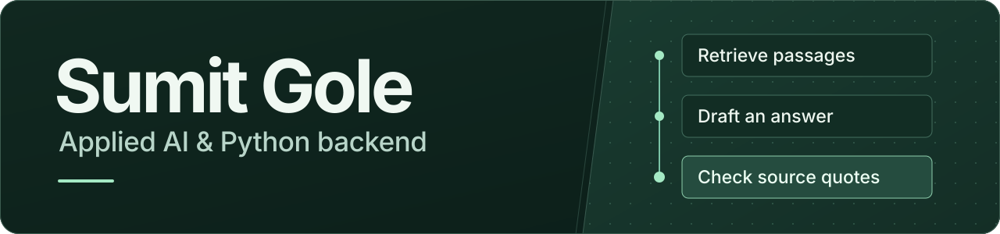

I build document Q&A apps that verify their source quotes and Python APIs that manage access to shared work. I previously interned at Ethara AI and am looking for entry-level applied AI and Python backend roles.

[**Developer portfolio**](https://sumitgole011.github.io/sumitgole011/) · [**Analytics dashboards**](https://sumitgole011.github.io/PowerBI-Industry-Analytics-Portfolio/) · [LinkedIn](https://www.linkedin.com/in/sumit-gole011/) · [Email](mailto:sumitgole011@gmail.com)

## Projects

| Project | Try it | Check the evidence |
| --- | --- | --- |
| [Mental Health Buddy](#mental-health-buddy) Document Q&A with source quotes | [32-second demo](https://github.com/sumitgole011/Mental-Health-RAG-Bot#live-demo) | [Retrieval pilot](https://github.com/sumitgole011/Mental-Health-RAG-Bot/blob/main/docs/retrieval-evaluation.md) |
| [AURA Salon Booking](#aura-salon-booking) Appointments and billing | [Live app](https://aura-salon-booking.sumitg.workers.dev/) | [27 API checks](https://github.com/sumitgole011/aura-salon-booking/actions/runs/44977663187) |
| [Team Task Manager](#team-task-manager) Project and task permissions | [Setup and API docs](https://github.com/sumitgole011/Team-task-Manager#readme) | [22 tests](https://github.com/sumitgole011/Team-task-Manager/actions/runs/44977768708) |
| [Multi-modal Travel Agent](#multi-modal-travel-agent) Document search and web routing | [Offline examples](https://github.com/sumitgole011/Multi-modal-travel-agent#offline-workflow-examples) | [6 checks](https://github.com/sumitgole011/Multi-modal-travel-agent/actions/runs/45011123568) |
| [Industry Analytics Portfolio](#industry-analytics-portfolio) Four dashboards on synthetic data | [Dashboard gallery](https://sumitgole011.github.io/PowerBI-Industry-Analytics-Portfolio/) | [Data validation run](https://github.com/sumitgole011/PowerBI-Industry-Analytics-Portfolio/actions/runs/45029922315) |

Click a project name to jump to its details, then expand the panel for screenshots, code, and evidence.

### Mental Health Buddy

A Flask app that ranks passages with TF-IDF and MiniLM, sends evidence to Groq, and verifies quotations before showing an answer. Hybrid and similarity search each found the annotated evidence for **8 of 10** fresh questions within the top two results.

<strong>See the cited answer, retrieval scores, and tests</strong>

The recording shows an answer to a question about relaxation, then shows the fallback for a question about Mars. The retrieval pilot separately checks whether the annotated passage appears among the top two passages. The reciprocal rank score also gives more credit to a hit ranked first.

| Method | Top-two hits | Mean reciprocal rank at 2 |
| --- | ---: | ---: |
| Hybrid search | **8 of 10** | 0.70 |
| Similarity search | 8 of 10 | 0.65 |
| Maximal marginal relevance | 5 of 10 | 0.50 |

[Repository](https://github.com/sumitgole011/Mental-Health-RAG-Bot) · [Retriever code](https://github.com/sumitgole011/Mental-Health-RAG-Bot/blob/main/retrieval.py) · [Reproduce the pilot](https://github.com/sumitgole011/Mental-Health-RAG-Bot/blob/main/docs/retrieval-evaluation.md#reproduce) · [Raw results](https://github.com/sumitgole011/Mental-Health-RAG-Bot/blob/main/evaluation/comparison_results.json)

[Quotation and fallback tests](https://github.com/sumitgole011/Mental-Health-RAG-Bot/blob/main/tests/test_chat.py) · [CI run with 15 passing tests](https://github.com/sumitgole011/Mental-Health-RAG-Bot/actions/runs/45010540723)

### AURA Salon Booking

A React and TypeScript app for salon appointments and invoices. The Cloudflare Workers API commits each booking and its occupied time slots in one D1 transaction.

<strong>See the booking screen, transaction, and API checks</strong>

In the live app, choose a service and date to see the available times. The CI suite uses D1-compatible SQLite to check overlapping bookings, rollback after a failed reschedule, and invoice prices saved at the time of billing.

[Repository](https://github.com/sumitgole011/aura-salon-booking) · [Booking sequence diagram](https://github.com/sumitgole011/aura-salon-booking/blob/main/docs/architecture.md#booking-flow) · [API implementation](https://github.com/sumitgole011/aura-salon-booking/blob/main/app/api/%5B...path%5D/route.ts) · [Regression tests](https://github.com/sumitgole011/aura-salon-booking/blob/main/tests/api.test.mjs)

### Team Task Manager

A Flask and SQLAlchemy app for assigning tasks and tracking progress across team projects.

<strong>Follow the permission rules and test cases</strong>

The tests exercise what owners, shared project members, and unrelated users can read or change. They also test role assignment during public signup and database rollback when project creation fails.

[Repository and setup](https://github.com/sumitgole011/Team-task-Manager#readme) · [Flask API](https://github.com/sumitgole011/Team-task-Manager/blob/main/app.py) · [Project and task access tests](https://github.com/sumitgole011/Team-task-Manager/blob/main/tests/test_access_controls.py) · [Signup role tests](https://github.com/sumitgole011/Team-task-Manager/blob/main/tests/test_signup_roles.py)

### Multi-modal Travel Agent

A Streamlit app that uses LangGraph to choose between local destination data and web search, then adds weather and images.

<strong>Compare the two routing examples</strong>

- **Paris** is in the simulated local index. The workflow uses the local record and skips web search.
- **Lisbon** misses the local index. The workflow searches the web and keeps the itinerary and images when the simulated weather request times out.

The two scenarios run in the offline CI suite with simulated provider responses.

[Repository and offline setup](https://github.com/sumitgole011/Multi-modal-travel-agent#offline-workflow-examples) · [LangGraph implementation](https://github.com/sumitgole011/Multi-modal-travel-agent/blob/main/multi-modal-travel-agent/travel_agent/graph.py) · [Workflow diagram](https://github.com/sumitgole011/Multi-modal-travel-agent/blob/main/multi-modal-travel-agent/graph.png) · [Routing tests](https://github.com/sumitgole011/Multi-modal-travel-agent/blob/main/tests/test_graph_routes.py)

### Industry Analytics Portfolio

Four interactive HTML dashboards explore recurring revenue, loan approvals, hospital operations, and order fulfillment using synthetic data. The SaaS case study also includes an editable Power BI project.

<strong>Open all four dashboards and reproduce the SaaS comparison</strong>

[SaaS](https://sumitgole011.github.io/PowerBI-Industry-Analytics-Portfolio/SaaS_Revenue_Churn_Intelligence/dashboard_preview.html) · [Banking](https://sumitgole011.github.io/PowerBI-Industry-Analytics-Portfolio/Banking_Credit_Risk_Intelligence/dashboard_preview.html) · [Healthcare](https://sumitgole011.github.io/PowerBI-Industry-Analytics-Portfolio/Healthcare_Operations_Intelligence/dashboard_preview.html) · [Supply chain](https://sumitgole011.github.io/PowerBI-Industry-Analytics-Portfolio/Supply_Chain_Inventory_Intelligence/dashboard_preview.html)

In the SaaS dashboard, set **Reporting period** to **Dec 2025**. Use **Customer segment** to compare **All segments** with **SMB**.

| Customer segment | Monthly recurring revenue (USD) | Customer churn | Net revenue retention |
| --- | ---: | ---: | ---: |
| All segments | 47,257.58 | 1.89% | 99.11% |
| SMB | 17,211.26 | 2.17% | 98.95% |

[Repository](https://github.com/sumitgole011/PowerBI-Industry-Analytics-Portfolio) · [Interview walkthrough](https://github.com/sumitgole011/PowerBI-Industry-Analytics-Portfolio/blob/main/SaaS_Revenue_Churn_Intelligence/INTERVIEW_GUIDE.md#december-smb-walkthrough) · [Editable Power BI project](https://github.com/sumitgole011/PowerBI-Industry-Analytics-Portfolio/blob/main/SaaS_Revenue_Churn_Intelligence/power-bi/SaaS%20Revenue%20and%20Churn.pbip) · [KPI reconciliation](https://github.com/sumitgole011/PowerBI-Industry-Analytics-Portfolio/tree/main/SaaS_Revenue_Churn_Intelligence#kpi-reconciliation) · [Dataset validation code](https://github.com/sumitgole011/PowerBI-Industry-Analytics-Portfolio/blob/main/validate_all.py)

<strong>Explore three more projects</strong>

| Project | Evidence |
| --- | --- |
| [YouTube Transcript Q&A](https://github.com/sumitgole011/YT-Video-Summarizer) | Flask transcript Q&A prototype. [Source contract tests](https://github.com/sumitgole011/YT-Video-Summarizer/blob/main/tests/test_api_contract.py) and [CI run with 3 passing tests](https://github.com/sumitgole011/YT-Video-Summarizer/actions/runs/39859625200). |
| [Retail Revenue & Profit Intelligence](https://github.com/sumitgole011/Retail-Revenue-Profit-Intelligence-PowerBI) | [Power BI report design PDF](https://github.com/sumitgole011/Retail-Revenue-Profit-Intelligence-PowerBI/blob/main/Sumit_Gole_Retail_Intelligence_Dashboard.pdf) and [validation of 1,200 synthetic transactions](https://github.com/sumitgole011/Retail-Revenue-Profit-Intelligence-PowerBI/actions/runs/39859487266). |
| [Go Mart Sales Analysis](https://github.com/sumitgole011/Go-Mart-Sales-Analysis) | [Excel dashboard screenshot](https://github.com/sumitgole011/Go-Mart-Sales-Analysis/blob/main/Dashboard.png) and [dataset attribution](https://github.com/sumitgole011/Go-Mart-Sales-Analysis#dataset). |

[Back to projects](#projects) · [Browse all repositories](https://github.com/sumitgole011?tab=repositories)
